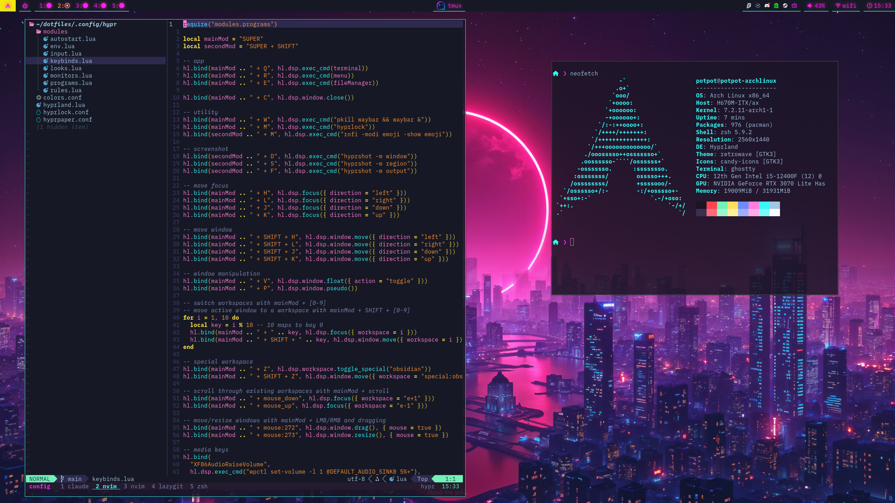

# dotfiles

some of my dotfiles.

currently have:

- [ghostty](.config/ghostty)
- [neovim](.config/nvim)
- [hypr](.config/hypr)
- [waybar](.config/waybar)
- [tmux](.config/tmux)
- [zsh](.zshrc)
- [starship](.config/starship.toml)



## setup

Works on Arch Linux and macOS.

```sh
git clone https://github.com/potpot1029/dotfiles ~/dotfiles
cd ~/dotfiles
./install.sh --packages   # fresh machine: install packages, then link configs
./install.sh              # later: just (re)link configs, safe to re-run
```

- packages live in `packages/`: `arch.txt` (pacman), `aur.txt` (yay/paru), `Brewfile` (macOS)
- configs in `.config/` are symlinked into `~/.config/`; `hypr` and `waybar` are skipped on macOS
- anything already in the way is moved to `~/dotfiles_old`